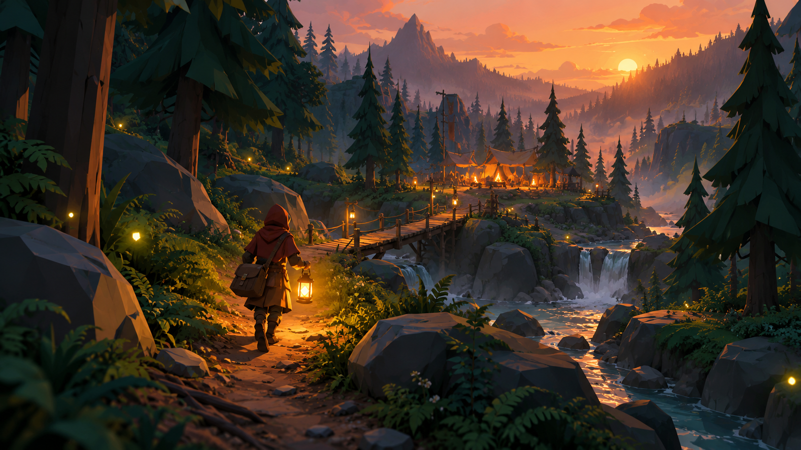
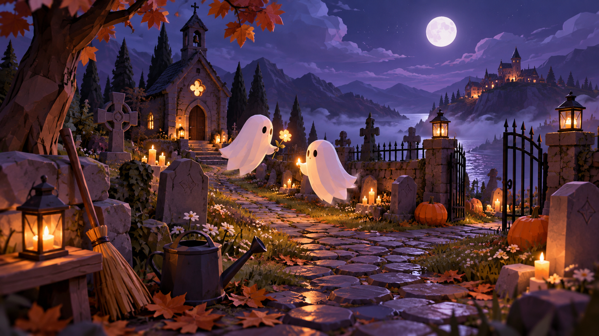
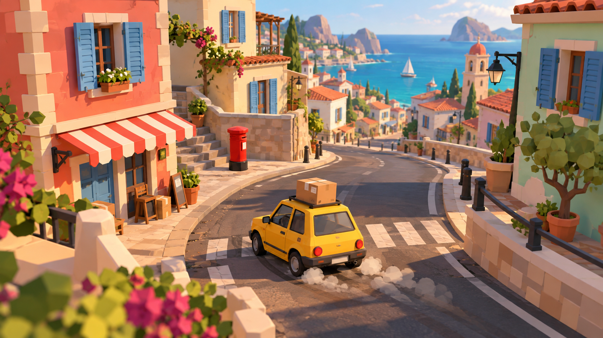
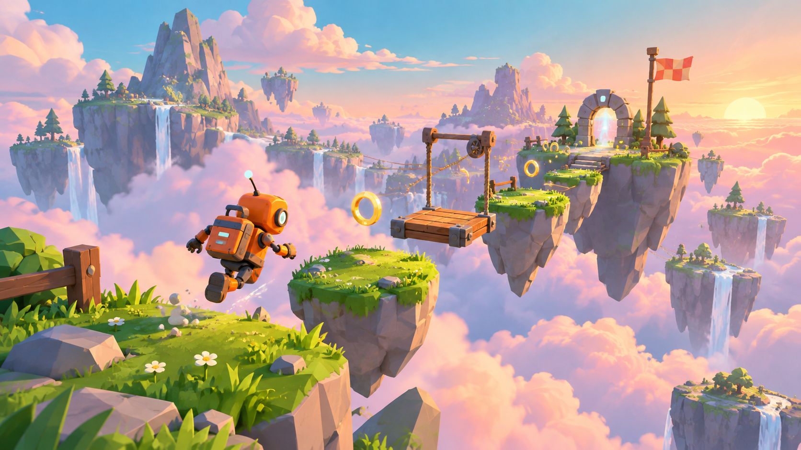

# Five Worlds: concept briefs

Five original 3D game ideas scoped as single-player first prototypes. All artwork is an AI-generated visual target; it is not gameplay or a pack preview.

## Last Light Courier

Carry the last lantern through a darkening forest, delivering supplies and relighting camps before your flame burns out.

**Hook**

Your light is both your compass and your countdown. Taking a shortcut saves time, but the safe route has fuel.

**First playable**

One compact woodland loop, three camps, three deliveries, a fuel meter, and one win/lose screen. Use static camps instead of animated NPCs.

**Custom work**

Lantern model and light, parcel, camp markers, interaction prompts, fuel logic, route layout, and sound. The third-person courier in the concept art is illustrative; the prototype uses a first-person camera.

**Learning goals**

Player movement, raycast interaction, lighting, UI signals, and a simple game state.

**Main risk**

Night lighting must keep the path readable on small screens. Start with a short route and soft ambient light.

**YouTube angle**

From greybox forest to glowing delivery route: a clear before-and-after reveal, with a final low-fuel run.

**Core loop**

1. Pick up a delivery and fill your lantern.
2. Choose a route through the forest and manage your fuel.
3. Reach a camp, relight its beacon, and unlock the next delivery.

## Orbit Salvage

Pilot a repair drone around a silent moon base, moving scarce power cells between machines to bring the rescue beacon online.

**Hook**

There is never enough power for everything at once. The puzzle is deciding what can switch off so something else can turn on.

**First playable**

One exterior base split into three puzzle areas, two movable cells, three machine types, and a final beacon. Hand-author every puzzle.

**Custom work**

A primitive drone, cell props, cable visuals, power-state materials, puzzle logic, interactions, and audio. Build the ground from simple meshes.

**Learning goals**

Object pickup, reusable interactables, state machines, puzzle dependencies, and emissive materials.

**Main risk**

Prevent softlocks by allowing cells to be recovered or adding a reset button for the current puzzle.

**YouTube angle**

A dead base lights up piece by piece. Show the power graph on screen as the puzzle is solved.

**Core loop**

1. Inspect a broken section of the base.
2. Carry a cell, power a machine, and open a new route.
3. Reclaim cells and reroute power until the beacon activates.

## Midnight Groundskeeper

Spend the night tending a tiny haunted cemetery: sweep paths, water spectral flowers, and fulfill gentle requests from its ghostly residents.

**Hook**

Every little chore makes the graveyard warmer and friendlier, turning a spooky place into somewhere you want to stay.

**First playable**

One enclosed cemetery, two tools, six chore spots, three ghost requests, and a single-night completion screen. Use progress bars for cleaning.

**Custom work**

Simple sheet ghosts, broom and watering can, flower effects, task UI, tool animations, and request logic. Ghosts can be mesh primitives with a bobbing animation.

**Learning goals**

Interaction targets, tool switching, progress feedback, task tracking, and environmental storytelling.

**Main risk**

Chores need satisfying feedback. Build one complete cleaning interaction before adding more tasks.

**YouTube angle**

A spooky-to-cozy transformation with an immediate visual payoff, ideal for a compact devlog.

**Core loop**

1. Read a ghost's small request.
2. Use the right tool to clean, water, or decorate.
3. Earn a glowing flower and bring color back to the cemetery.

## Pocket Post

Zip a tiny delivery car through a toy-sized town, chaining parcel drops into one perfect route before the shift ends.

**Hook**

Speed helps, but a clever route wins. String deliveries together to keep your combo alive.

**First playable**

One car, one small loop of streets, five delivery points, a 90-second timer, and a score screen. Start with stationary scenery and no traffic AI.

**Custom work**

Arcade car controller, chase camera, parcel and mailbox props, delivery zones, combo UI, road layout, and sound. Recolor a pack car to create the courier vehicle.

**Learning goals**

Movement and steering, camera smoothing, trigger zones, timers, scoring, and reset flow.

**Main risk**

Vehicle handling takes tuning. Use a simple arcade body with grounded movement before attempting realistic suspension.

**YouTube angle**

An instantly readable challenge: can you deliver all five parcels in 90 seconds? Show the route and final combo.

**Core loop**

1. Collect a batch of parcels from the depot.
2. Choose a delivery order and drive to marked drop points.
3. Chain quick deliveries, bank a score, and retry for a better route.

## Cloudline

Leap across floating islands and ride moving platforms, collecting wind rings on a short skyward course built for satisfying retries.

**Hook**

An easy route gets you home; a daring route collects every ring. Master the same small level instead of exploring a huge world.

**First playable**

One course with 12 islands, one moving-platform type, two checkpoints, ten rings, and a finish timer. Use the pack's animated character for the first build.

**Custom work**

Jump controller, checkpoint system, moving-platform logic, floating-island composition, ring pickups, and UI. The orange robot in the concept art is an optional custom skin, not an included model.

**Learning goals**

Character movement, jump forgiveness, moving platforms, camera collision, checkpoints, and collectibles.

**Main risk**

Camera and jump feel are the main work. Tune a three-platform greybox before dressing the entire course.

**YouTube angle**

Turn three grey cubes into a sky-island course, then finish with a clean no-fall run.

**Core loop**

1. Read the next island and time a jump.
2. Ride platforms, collect rings, and reach a checkpoint.
3. Finish the course, then retry for fewer falls and a faster time.
